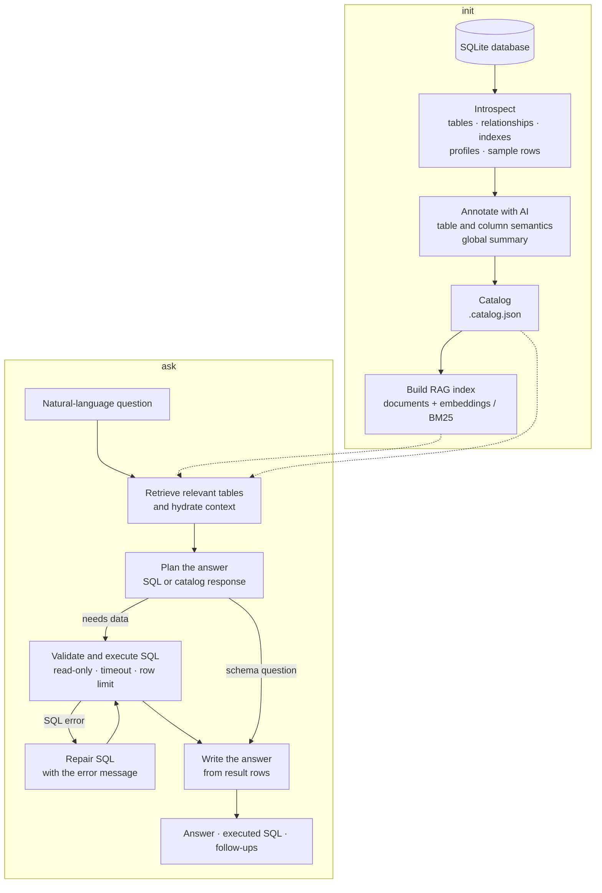

# SQLiteX

**Turn any SQLite database into a documented, queryable knowledge base — from your terminal.**

[](https://hub.docker.com/r/luisfercli/sqlitex)
[](LICENSE)

SQLiteX is a 100% CLI Python tool that inspects a SQLite database, understands its tables, columns, relationships, and the data they hold, and then lets you ask business questions in plain language. It uses an LLM to generate read-only SQL, runs it safely, and explains the result.

No dashboards. No notebooks. No vector database to operate. Just your `.sqlite` file, a model endpoint, and questions.

```console
$ sqlitex ask "which products generated the most revenue in 2025?" --db demo.sqlite

╭─ Answer ──────────────────────────────────────────────────────────────╮
│ In 2025, the top three products by revenue were the Atlas 14 Laptop   │
│ (€12,480.50), the Vega 27 Monitor (€7,910.20), and the 1 TB SSD       │
│ Drive (€5,640.00). Together they account for 38% of total revenue.    │
╰───────────────────────────────────────────────────────────────────────╯

╭─ Executed SQL ────────────────────────────────────────────────────────╮
│ SELECT p.name, ROUND(SUM(oi.quantity * oi.unit_price), 2) AS revenue  │
│ FROM order_items oi JOIN products p ON p.id = oi.product_id           │
│ JOIN orders o ON o.id = oi.order_id                                   │
│ WHERE o.ordered_at >= '2025-01-01' AND o.ordered_at < '2026-01-01'    │
│ GROUP BY p.id ORDER BY revenue DESC LIMIT 3;                          │
╰───────────────────────────────────────────────────────────────────────╯
```

## Why SQLiteX?

Most "chat with your data" tools assume a data warehouse, a cloud account, or a notebook. SQLiteX assumes you have a single file.

- **Understands the database before answering.** `init` extracts schema, keys, indexes, triggers, samples, column profiles, and AI-generated semantics.
- **RAG over the schema, not over raw rows.** Relevant tables, columns, meanings, and value distributions are retrieved before SQL generation.
- **Feels like a conversation.** `ask` for one-shot questions, `chat` for follow-ups with history.
- **Safe by design.** Read-only connection, `query_only`, an SQLite authorizer that denies writes/DDL/PRAGMA mutations, a single-statement guard, timeouts, and row limits.
- **Self-correcting.** If generated SQL fails, the error is sent back to the model for a repair attempt.
- **Works with any OpenAI-compatible endpoint.** OpenAI, OpenRouter, Ollama, LM Studio, vLLM, OpenCode Go, and friends.
- **Degrades gracefully.** No embeddings endpoint? It uses BM25 lexical retrieval and keeps working.

## Install

Requirements: Python 3.11+ and [uv](https://docs.astral.sh/uv/) (recommended).

```bash
git clone https://github.com/luisfer-cli/sqlitex.git
cd sqlitex

uv sync
uv run sqlitex --help
```

Install it as a command in the environment:

```bash
uv pip install -e .
sqlitex --help
```

Or run it without installing:

```bash
uv run python -m sqlitex --help
```

## Docker

A multi-stage `Dockerfile` is included. It installs SQLiteX into an isolated virtual environment, runs as a non-root user, and uses `/data` as the working volume.

Pull the published image:

```bash
docker pull luisfercli/sqlitex:latest
docker run --rm luisfercli/sqlitex:latest version
docker run --rm luisfercli/sqlitex:latest --help
```

Also available as `luisfercli/sqlitex:0.1.0`.

Or build it locally:

```bash
docker build -t sqlitex .
```

The examples below use an `IMAGE` variable, so they work with either source:

```bash
IMAGE=luisfercli/sqlitex:latest   # or IMAGE=sqlitex after a local build

docker run --rm "$IMAGE" --help
docker run --rm "$IMAGE" version
```

Use a host directory for the database and local state:

```bash
mkdir -p data
docker run --rm -v "$PWD/data:/data" "$IMAGE" demo /data/demo.sqlite
docker run --rm -v "$PWD/data:/data" "$IMAGE" init /data/demo.sqlite
docker run --rm -v "$PWD/data:/data" "$IMAGE" ask "which products sold the most units?" --db /data/demo.sqlite
```

`SQLITEX_HOME` defaults to `/data/.sqlitex` inside the container, so catalogs and indexes persist in the mounted directory.

Pass provider settings without baking secrets into the image:

```bash
docker run --rm -it \
  -v "$PWD/data:/data" \
  -e SQLITEX_API_BASE_URL \
  -e SQLITEX_API_KEY \
  -e SQLITEX_MODEL \
  "$IMAGE" ask "how many customers are there?" --db /data/demo.sqlite
```

The container runs as UID/GID `1000`. If your host user has different IDs, add `--user "$(id -u):$(id -g)"` so generated files stay writable on the host. The entrypoint is `sqlitex`; use `--entrypoint bash` if you need a shell inside the image.

`-e VAR` reads the value from your shell. If you prefer a file, use `--env-file .env.docker`; Docker does not expand `${...}` references there, so the values must be literal.

## Quickstart

1. Configure an AI provider:

   ```bash
   cp .env.example .env
   $EDITOR .env
   ```

   OpenAI:

   ```dotenv
   SQLITEX_API_BASE_URL=https://api.openai.com/v1
   SQLITEX_API_KEY=sk-...
   SQLITEX_MODEL=gpt-4o-mini
   ```

   Local Ollama (no real API key required):

   ```dotenv
   SQLITEX_API_BASE_URL=http://localhost:11434/v1
   SQLITEX_API_KEY=ollama
   SQLITEX_MODEL=llama3.1
   SQLITEX_EMBEDDINGS=off
   ```

2. Create a demo database and analyze it:

   ```bash
   uv run sqlitex demo demo.sqlite
   uv run sqlitex init demo.sqlite
   ```

3. Ask questions:

   ```bash
   uv run sqlitex ask "which products sold the most units?" --db demo.sqlite
   uv run sqlitex ask "which customers spent the most last year?" --db demo.sqlite
   uv run sqlitex chat --db demo.sqlite
   ```

`init` takes a few seconds because it makes one model call per table. Everything is cached in `.sqlitex/`, so later `ask` calls start immediately.

## Commands

| Command | What it does |
| --- | --- |
| `sqlitex init <db>` | Inspect the database, document it with AI, and build the RAG index. |
| `sqlitex ask "<question>"` | Answer a question with RAG + generated SQL. |
| `sqlitex chat` | Interactive conversation with history. |
| `sqlitex schema [table]` | Show the catalog, one table, or an ER diagram. |
| `sqlitex describe <table>` | Show columns, relationships, indexes, and sample rows. |
| `sqlitex query "<sql>"` | Run SQL manually in strict read-only mode. |
| `sqlitex reindex` | Rebuild the index (for example after changing embedding models). |
| `sqlitex status` | List catalogs and their state. |
| `sqlitex doctor` | Diagnose config, database, catalog, index, and API. |
| `sqlitex config` | Show effective configuration without revealing the API key. |
| `sqlitex demo [path]` | Generate a sample e-commerce database. |
| `sqlitex version` | Show the installed version. |

### `init`

```bash
sqlitex init data.sqlite
sqlitex init data.sqlite --no-ai        # introspection only
sqlitex init data.sqlite --force        # re-annotate everything
sqlitex init data.sqlite --no-profile   # faster, no column profiles
sqlitex init data.sqlite --lexical      # no embeddings, BM25 index
sqlitex init data.sqlite --json         # machine-readable summary
```

It extracts:

- tables, views, and virtual tables (hiding FTS/rtree shadow tables);
- columns, declared types, `NOT NULL`, defaults, and primary keys;
- declared foreign keys and **inferred** relationships from names like `customer_id`;
- indexes, triggers, and DDL;
- row counts, size, pragmas, and SQLite version;
- sample rows (truncated values);
- per-column profiles: null ratio, distinct count, ranges, and frequent values;
- AI annotations per table/column: summary, purpose, entity, column meanings, tags, example questions, data-quality notes, and possible PII.

Annotations are cached by schema fingerprint, so running `init` again without changes reuses them.

### `ask`

```bash
sqlitex ask "how many orders were cancelled this year?" --db data.sqlite
sqlitex ask "revenue by category" --db data.sqlite --no-sql
sqlitex ask "inactive customers" --db data.sqlite --max-rows 20 --top-k 8
sqlitex ask "summarize this database" --db data.sqlite --json
```

- `--sql/--no-sql`: show or hide the executed query.
- `--max-rows`, `--top-k`: row and retrieved-table limits.
- `--retrieval hybrid|lexical|vector|off`: change the retrieval strategy.
- `--json`: returns question, SQL, rows, tables used, timings, and errors.

If SQL fails, SQLiteX explains the error to the model and retries (`SQLITEX_SQL_RETRIES`, default 2). If the question is about the schema ("what data is there?"), it answers from the catalog without executing SQL.

### `chat`

A REPL with history for references like "and the previous month":

```text
/tables              list tables
/describe <table>    show table details
/schema              show the database overview
/sql <query>         run read-only SQL
/clear               clear history
/exit                exit
```

The last `SQLITEX_HISTORY_TURNS` turns are sent to the model for context.

### `schema` and `describe`

```bash
sqlitex schema data.sqlite
sqlitex schema orders --db data.sqlite
sqlitex schema --mermaid --db data.sqlite
sqlitex describe orders --db data.sqlite
sqlitex schema --json --db data.sqlite
```

The Mermaid diagram can be pasted into GitHub, Notion, or [mermaid.live](https://mermaid.live). Inferred relationships use dashed lines.

## Configuration

SQLiteX reads `.env` from the current directory (or its parents) and process environment variables. Environment variables win.

| Variable | Default | Description |
| --- | --- | --- |
| `SQLITEX_API_BASE_URL` | `https://api.openai.com/v1` | OpenAI-compatible endpoint. |
| `SQLITEX_API_KEY` | — | Provider key. Local endpoints can use any text. |
| `SQLITEX_MODEL` | `gpt-4o-mini` | Chat model. |
| `SQLITEX_EMBED_MODEL` | `text-embedding-3-small` | Embedding model. |
| `SQLITEX_EMBED_BASE_URL` | same as chat | Alternative embeddings endpoint. |
| `SQLITEX_EMBED_API_KEY` | same as chat | Alternative embeddings key. |
| `SQLITEX_EMBEDDINGS` | `auto` | `auto`, `on`, or `off`. Falls back to BM25. |
| `SQLITEX_DB` | — | Default database, so you can omit `--db`. |
| `SQLITEX_HOME` | `./.sqlitex` | Catalog and index directory. |
| `SQLITEX_LANGUAGE` | `en` | Annotation language (en, es, pt, fr, de, it). |
| `SQLITEX_MAX_ROWS` | `50` | Maximum rows per query. |
| `SQLITEX_QUERY_TIMEOUT` | `10` | Maximum SQL execution time in seconds. |
| `SQLITEX_SQL_RETRIES` | `2` | Automatic SQL repair attempts. |
| `SQLITEX_RETRIEVAL` | `hybrid` | `hybrid`, `lexical`, `vector`, or `off`. |
| `SQLITEX_TOP_K` | `6` | Tables retrieved for context. |
| `SQLITEX_ALL_TABLES_THRESHOLD` | `6` | Include the whole schema for small databases. |
| `SQLITEX_CONTEXT_MAX_CHARS` | `24000` | Maximum context size. |
| `SQLITEX_HISTORY_TURNS` | `3` | Turns remembered in `chat`. |
| `SQLITEX_ENRICH_MAX_TABLES` | `200` | Maximum tables annotated by AI. |
| `SQLITEX_ENRICH_WORKERS` | `4` | Parallel AI calls. |
| `SQLITEX_SAMPLE_ROWS` | `3` | Sample rows per table. |
| `SQLITEX_PROFILE_SAMPLE_ROWS` | `500` | Rows used to profile columns. |
| `SQLITEX_PROFILE_MAX_COLUMNS` | `120` | Maximum profiled columns. |
| `SQLITEX_TEMPERATURE` | `0` | Model temperature. |
| `SQLITEX_TIMEOUT` | `60` | HTTP timeout per model call. |
| `SQLITEX_JSON_MODE` | `false` | Enable `response_format=json_object` if supported. |
| `SQLITEX_EXTRA_HEADERS` | — | Extra HTTP headers as JSON (OpenRouter, etc.). |
| `SQLITEX_DEBUG` | `false` | Show token usage and internal details. |

## How it works



1. **Introspection** (`introspect.py`): reads schema via `pragma_table_info`, `pragma_foreign_key_list`, `pragma_index_list`, etc.; counts rows with a timeout; samples rows; profiles columns on a sample to avoid blocking large databases.
2. **Annotation** (`enrich.py`): one call per table (in parallel) with DDL, profiles, and samples. The model returns JSON validated by Pydantic. A final call summarizes the domain and main entities.
3. **Index** (`index.py`): each table and the global summary become text documents. Embeddings are generated when the endpoint is available and normalized for cosine similarity; otherwise BM25 is used.
4. **Retrieval** (`index.py`): 55% vector + 45% lexical hybrid search, boosted when a table name appears in the question. For small schemas, the whole schema is included. Relationships expand by one hop so the model can join tables.
5. **SQL** (`ask.py` + `query.py`): the model returns `{"mode":"sql","sql":...}` or `{"mode":"catalog","answer":...}`. SQL is validated and executed on a `mode=ro` connection with `PRAGMA query_only`, an authorizer that denies writes, a timeout, and a row cap. On error, it retries with the error message.
6. **Answer** (`ask.py`): the model receives the question, SQL, and a compact result table, then writes a clear answer without inventing figures, warning when the result is truncated and suggesting follow-up questions.

Local state lives in `SQLITEX_HOME` (default `.sqlitex/`):

- `<name>-<hash>.catalog.json`: schema + documentation + samples.
- `<name>-<hash>.index.json`: documents and index metadata.
- `<name>-<hash>.vectors.npy`: normalized embedding matrix.

## Example questions

With the demo database:

```bash
sqlitex ask "which products generated the most revenue?"
sqlitex ask "monthly trend of delivered orders in 2025"
sqlitex ask "which category has the best average rating?"
sqlitex ask "customers from Mexico who spent the most"
sqlitex ask "cancelled orders by channel"
sqlitex ask "products with low stock and high sales"
sqlitex ask "what does the segment column mean?"
sqlitex ask "what personal data does this database store?"
```

## Safety

- **Real read-only mode**: URI `mode=ro`, `PRAGMA query_only=ON`, an *authorizer* that denies `INSERT/UPDATE/DELETE/DDL/PRAGMA mutations/ATTACH/VACUUM`, and a statement check allowing only `SELECT`, `WITH`, or `EXPLAIN`.
- **Single statement**: `sqlite3.execute` rejects multiple statements; trailing semicolons are stripped.
- **Limits**: `SQLITEX_MAX_ROWS` and `SQLITEX_QUERY_TIMEOUT` prevent full-table dumps and blocking queries.
- **Data exposure**: sample rows are sent to the configured AI provider. For sensitive data, use a local endpoint (Ollama/LM Studio) or review the PII annotations. Reduce exposure with `SQLITEX_SAMPLE_ROWS=0` and `--no-profile`.
- **Local catalog**: the catalog contains sample data; treat it as a sensitive file.

## Evaluation

The repository includes an end-to-end benchmark with synthetic databases and SQL-computed ground truth:

```bash
uv run python scripts/eval_live.py --rebuild
```

Latest run (6 databases, 24 questions, `deepseek-v4.1-flash`): **24/24** correct answers, **33/33** objects annotated, **3.5 s** average per question. Details, findings, and limitations are in [EVALUATION.md](EVALUATION.md). The generated report is saved to `eval-results/report.md`.

## Limitations

- SQLite only (no other engines).
- Generated SQL depends on model quality; inspect `--sql` for critical questions.
- Inferred relationships can be false positives.
- Re-run `init` after schema changes; run `reindex` after changing embedding models.
- `init` cost scales with the number of tables (one AI call per table).
- Results are capped at `SQLITEX_MAX_ROWS`; use `query` with aggregations for large analyses.
- No parameterized manual SQL and no writes, by design.

## Project structure

```
src/sqlitex/
  cli.py          Typer commands
  config.py       .env and Settings
  introspect.py   schema extraction and profiling
  enrich.py       AI documentation
  index.py        documents, embeddings, and BM25
  context.py      prompt context builder
  ask.py          RAG + NL2SQL pipeline
  query.py        read-only SQL execution
  render.py       Rich output
  demo.py         sample database
scripts/
  eval_data.py    synthetic evaluation databases
  eval_live.py    end-to-end benchmark
tests/
Dockerfile        multi-stage production image
.dockerignore     minimal build context
```

## Development

```bash
uv sync
uv run ruff check .
uv run ruff format .
uv run pytest
```

## License

MIT
